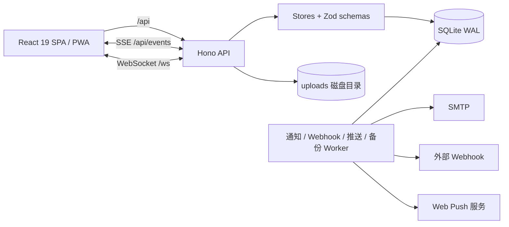

# Pulse 当前功能说明

> 适用版本：Clay Dashboard / Pulse 1.0.0  
> 数据库 schema：SQLite v18  
> API：OpenAPI 3.1，272 个路径 / 334 个操作  
> 文档更新：2026-10-27

本文档描述当前代码中已经实现并验收的功能。管理员可在「运维面板」通过功能开关关闭部分入口；除特别说明外，功能默认开启。部署与升级步骤见 [deployment.md](deployment.md)，逐项验收证据见 [acceptance.md](acceptance.md)。

---

## 1. 产品定位与技术栈

Pulse 是一个面向团队的分析与项目协作工作台，将经营指标、项目执行、任务协作、实时活动、通知与运维能力集中在同一个可部署应用中。
- 后端：Node.js 24.x / 26.x、Hono、Node 内置 `node:sqlite`、Zod、OpenAPI 3.1。
- 前端：React 19、React Router 7、Recharts、Vite，构建为单页应用。
- 实时：SSE（服务端事件流）与 WebSocket（项目编辑状态）。
- 存储：SQLite（WAL）保存业务数据；附件与头像保存在磁盘目录。
- 部署：单进程 Node 服务，同源提供 API 与前端静态资源；支持 Docker Compose 和反向代理。
- 测试：`node:test` 后端测试、Vitest 前端测试、Playwright 端到端与 axe 无障碍扫描。



---

## 2. 快速体验

```bash
nvm use
npm ci
npm run dev
```

打开 <http://localhost:5173>。演示模式默认启用，密码统一为 `Demo1234!`：

| 角色     | 邮箱               | 姓名 |
| -------- | ------------------ | ---- |
| 管理员   | admin@pulse.demo   | 林晓 |
| 业务经理 | manager@pulse.demo | 陈墨 |
| 项目经理 | pm@pulse.demo      | 周岚 |
| 只读成员 | viewer@pulse.demo  | 顾言 |

演示数据与数据库写入 `data/pulse.db`。生产环境应设置 `DEMO_MODE=0` 并提供 `ADMIN_EMAIL` / `ADMIN_PASSWORD`，否则服务会拒绝启动或要求引导首个管理员。

---

## 3. 角色、权限与可见范围

### 3.1 内置角色

| 能力                     | 管理员 | 业务经理 | 项目经理    | 只读成员    |
| ------------------------ | ------ | -------- | ----------- | ----------- |
| 创建项目                 | 支持   | 支持     | 支持        | 不支持      |
| 导入项目                 | 支持   | 支持     | 不支持      | 不支持      |
| 查看工作区内可见项目     | 支持   | 支持     | 仅本人/加入 | 仅本人/加入 |
| 管理所有项目             | 支持   | 支持     | 仅本人项目  | 不支持      |
| 查看成员目录             | 支持   | 支持     | 不支持      | 不支持      |
| 管理成员、角色与工作区   | 支持   | 不支持   | 不支持      | 不支持      |
| 查看审计中心             | 支持   | 不支持   | 不支持      | 不支持      |
| 使用运维面板             | 支持   | 不支持   | 不支持      | 不支持      |
| 评论、上传附件、修改任务 | 支持   | 支持     | 支持        | 只读        |

该表仅列举内置角色；自定义角色可以在基础角色之上附加权限。

权限以服务端判定为准，前端导航和按钮只是同步展示。

### 3.2 项目级可见性

- 项目负责人和项目成员始终可以访问项目。
- 管理员可以访问当前工作区内全部项目，包括私密项目。
- `workspace` 可见项目：拥有 `projects.view_all` 权限的角色（管理员、业务经理）可以查看。
- `private` 私密项目：仅负责人、成员和管理员可见；不会出现在其他成员的列表、搜索、活动或 Webhook 中。
- 项目经理可以查看本人或被加入的项目，但只能管理自己拥有的项目。
- 只读成员可以查看本人或被加入的项目，但不能执行写操作。
- 项目列表、详情、活动、搜索、评论、附件等接口均复用同一套可见性判断。

### 3.3 自定义角色

- 每个工作区可以创建自定义角色，指定一个基础角色并附加权限。
- 自定义角色只能**叠加**权限，不能收回基础角色已有的权限。
- 有效权限在每次请求时从数据库计算，修改或删除角色后无需重新登录即可生效。
- 管理员可以修改成员的基础角色、自定义角色和工作区归属。

### 3.4 功能开关

运维面板提供以下开关，关闭后相应入口会从界面移除：

| 开关                 | 影响范围                 |
| -------------------- | ------------------------ |
| `analytics`          | 侧栏分析与分析页入口     |
| `audit_center`       | 侧栏审计中心入口         |
| `webhooks`           | 设置页 Webhook 集成卡片  |
| `push_notifications` | 设置页浏览器通知卡片     |
| `project_templates`  | 项目页「从模板创建」入口 |
| `enterprise`         | 侧栏企业工作台入口       |

功能开关用于控制界面能力展示，不是权限系统或 API 安全边界。

---

## 4. 功能模块

### 4.1 登录、账户与会话安全

- 邮箱 + 密码登录；密码使用异步 `scrypt` 哈希。
- 未开启 MFA 时直接建立会话；开启 MFA 后需提交 TOTP 验证码完成第二步登录。
- 支持 TOTP 多因素认证、8 个一次性恢复码、启用/关闭 MFA。
- 密码规则校验弱口令与常见密码；修改密码会吊销其他会话。
- 忘记密码：生成 30 分钟有效、单次使用的重置令牌；未配置 SMTP 时记录告警且不回传令牌。
- 管理员可将成员密码重置为一次性临时密码。
- 登录失败限制：单账户 10 次、单 IP 30 次 / 15 分钟；失败记录持久化并写入审计。
- 会话列表展示设备、IP、最近活跃时间与过期时间；支持吊销单个会话或全部其他会话。
- 会话默认 12 小时空闲超时；管理员停用账户或修改密码会吊销相关会话与 WebSocket。
- 会话 Cookie 为 `HttpOnly` + `SameSite=Lax`；HTTPS 下使用 `__Host-` 前缀。
- 用户可以修改姓名、时区、登录邮箱、密码，上传/移除头像，或注销自己的账号。
- 管理员执行 GDPR 导出或匿名化删除时，会转移项目、撤销会话/令牌/Webhook，并清理个人偏好与通知；拒绝删除最后一名管理员或自删。

### 4.2 总览工作台

- 首页展示 KPI、收入趋势、渠道构成、项目概览和近期活动。
- 日期范围支持：今天、最近 7 天、最近 30 天、本月、上月、自定义范围。
- 自定义范围上限 366 天；日/月边界按工作区时区计算。
- 支持与上一周期对比；图表提供文本摘要、隐藏数据表和键盘导航。
- 首屏直接读取用户默认日期范围，避免重复请求。
- 活动、项目与在线状态通过实时连接更新。

### 4.3 项目管理

- 项目字段：名称、描述、状态、进度、负责人、成员、开始/截止日期、标签、可见范围。
- 状态：规划中、进行中、暂停、已完成、已归档；进度可由任务完成度自动汇总。
- 列表支持关键词、状态、负责人、排序、标签、截止时间、收藏和网格/列表视图。
- 截止时间筛选：已逾期、7 天内、30 天内；逾期排除已完成和已归档项目。
- 标签最多 5 个，去重且单个 1–24 字符；列表提供按当前筛选计算的标签分面。
- 收藏按用户隔离，可只看收藏。
- 个人视图可保存搜索、状态、负责人、排序、标签、截止时间、收藏、视图模式和每页数量；每人最多 20 个。
- 每页条数支持 12 / 24 / 48；分页上限 50。
- 批量操作：修改状态、转移负责人、归档；逐项跳过无权限或无变化的项目，返回 `{ updated, skipped }`。
- 编辑使用 `version` 乐观锁，冲突返回 409 和最新数据，前端提示并刷新。
- 归档项目可在归档视图中查看并一键恢复。
- 删除进入回收站（软删除）；墓碑项目访问返回 410；管理员可恢复、彻底删除，或等待到期自动清理（默认 30 天）。
- 项目可复制，并选择日期偏移及是否复制成员、任务与里程碑；评论和活动不复制。
- 提供 4 套内置模板：产品发布、客户交付、营销活动、双周迭代；可指定开始日期和负责人一次生成项目、里程碑与任务。
- 项目 CSV/JSON 导入支持字段别名、预览确认、逐行错误行号、文件内/库内重名检测；默认上限 2MB / 5000 行。
- 项目 CSV 导出遵循当前筛选与权限范围，超过 `EXPORT_MAX_ROWS`（默认 10000 行）返回 413。
- 项目详情集中展示成员、任务、评论、附件和活动。

### 4.4 任务、子任务与里程碑

- 任务字段：标题、描述、状态、优先级、负责人、截止日期、所属里程碑、排序、版本与评论数。
- 状态：待办、进行中、待审核、已完成；优先级：低、中、高、紧急。
- 支持一层子任务；父任务必须属于同一项目，子任务不能继续嵌套。
- 删除父任务会级联删除子任务；删除里程碑会保留任务并解除关联。
- 完成度按叶子任务自动汇总，并同步回项目的进度与版本。
- 提供四种视图：
  - 列表：行内切换状态、编辑与删除。
  - 看板：按 4 个状态分列，支持拖拽移动，并提供状态下拉作为无障碍替代。
  - 时间线：按已逾期、今天、未来 7 天、未来 30 天、更晚、未排期分组，并展示里程碑。
  - 日历：周一开头的月视图，标记今天、里程碑和每日任务；超出 2 条折叠为 `+n`，支持翻月。
- 任务创建、更新、完成、重新打开、删除以及里程碑变化会写入活动流并经 SSE 推送。
- 项目详情页通过 WebSocket 展示「X 正在编辑项目」的输入状态。

### 4.5 评论、提及与通知

- 支持项目评论和任务评论；任务删除时关联评论与通知级联清理。
- 评论可 @ 项目成员；提及范围限制在负责人和成员中，重复提及自动去重。
- 只读成员可以阅读评论，但不能发表或删除。
- 评论作者或项目管理者可以删除评论。
- 通知类型：提及、评论、任务分配、每周摘要。
- 通知铃铛显示未读数，支持按 ID 或全部标记已读。
- 通知可深链到项目或任务；`?task=` 会自动打开对应任务评论。
- 用户可在偏好中开启/关闭邮件通知与每周摘要。
- 邮件通过数据库发件箱队列异步发送，按 ISO 周去重摘要；失败按 1 分钟、5 分钟、30 分钟、2 小时、12 小时退避，最多 5 次。
- 未配置 SMTP 时站内通知仍可用，仅跳过邮件投递。
- 通知保留 180 天，已发送邮件记录保留 30 天。

### 4.6 附件与头像

- 项目附件支持图片、PDF、文本、CSV、JSON、ZIP 和 Office 文件。
- 上传时同时校验扩展名、声明 MIME 与文件魔数；拒绝空文件、可执行文件和 EICAR 测试病毒。
- 文件名取 basename 并剥离控制字符，不暴露文件系统路径。
- 单文件上限 10MB；每个项目最多 50 个附件、总计 100MB。
- 下载使用 HMAC-SHA256 签名的私有链接，10 分钟有效；响应带 `nosniff`、私有缓存和 RFC 5987 文件名。
- 上传需要项目写权限；删除仅限上传者或项目管理者；文件与记录同步删除并写审计。
- 头像上传上限 2MB，仅支持 PNG/JPEG/GIF/WebP；浏览器端居中裁切为 256×256 JPEG 后上传。
- 头像按用户 ID 落盘，导航、成员、搜索、评论等位置复用头像并回退到姓名首字。
- **当前限制**：附件存储在单机磁盘，多实例部署需替换为对象存储；数据库备份不包含附件目录，附件需单独纳入备份。

### 4.7 分析、币种与报表

- 分析页覆盖收入趋势、渠道份额、客户与转化指标、项目状态分布。
- 支持日期范围和上一周期对比；区间边界遵循工作区时区。
- 金额以美元分为基准存储，读取时按工作区汇率换算为展示币种。
- 内置币种：USD、CNY、EUR、GBP、JPY、HKD、SGD；管理员可修改展示币种和汇率。
- 管理员可通过 CSV/JSON API 或上传文件导入日指标，按日期 UPSERT；上限 2MB / 366 行，逐行返回错误。
- 展示指标数据源覆盖范围，支持收入、渠道、受众 CSV 导出。
- 用户可保存报表，并设置每周或每月邮件发送；报表为个人私有，可导出、修改频率或删除。
- 到期报表经发件箱发送，去重键包含报表与下次运行时间，日志只记录报表 ID。
- 图表支持 CSV 导出和 2× PNG 导出；动画遵循 `prefers-reduced-motion`。

### 4.8 实时协作与在线状态

- SSE 端点 `/api/events` 按权限裁剪事件。
- 客户端携带 `Last-Event-ID` 重连时先收到轻量 `resume`，只补发断线期间可见活动。
- 缺口超过 200 条时发送 `resync` 全量快照，并触发前端刷新，避免静默丢事件。
- 在线状态使用 1 秒节流和 `join` / `leave` 增量，仅包含 ID、姓名和加入时间。
- 侧栏显示实际连接人数，悬停可查看昵称。
- WebSocket `/ws` 用于项目编辑输入状态：1500ms 节流发送，4 秒无消息自动清除，断线 3 秒重连。
- WebSocket 需要有效会话 Cookie，个人访问令牌不能用于 WebSocket。
- 前端实时刷新按 250ms 合并调度，一批活动只触发一轮请求。
- SSE 默认上限：全局 200 个连接、单 IP 10 个、握手 30 次，可通过环境变量调整。

### 4.9 全局搜索

- 顶部搜索框支持 `Cmd/Ctrl+K` 聚焦。
- 结果按项目、活动、成员分区展示，并提供「查看全部结果」入口。
- 支持 `ArrowUp` / `ArrowDown` / `Enter` / `Esc` 键盘操作和 combobox 语义。
- 保存最近 5 条搜索记录到本地。
- 输入达到 2 个字符后搜索，并以 `AbortController` 取消旧请求。
- 活动与用户使用 SQLite FTS5 trigram 索引和 BM25 排序，活动摘要返回 `<mark>` 高亮。
- 短词或混排场景回退为逐词 `LIKE`；项目搜索为多词 AND。
- 搜索范围严格受当前用户权限和工作区限制。

### 4.10 活动流

- 项目、任务、评论、成员、归档、恢复、里程碑、导入导出等操作写入活动流。
- 使用单调递增 `seq` 游标分页，列表分页上限 50。
- 支持按活动类型、项目、成员等条件筛选。
- 活动通过 SSE 实时推送，客户端按可见性接收。
- 活动保留期和行数上限可配置，防止无限增长。

### 4.11 审计中心

- 前端页面入口仅管理员可访问；API 按 `audit.view` 权限判定。
- 记录项目 CRUD、归档/恢复/彻底删除、导入/导出、模板应用、项目复制、批量修改、偏好变更、登录失败、令牌、Webhook、附件、头像、工作区、运维操作等。
- 支持关键词、动作、操作者、起止日期筛选与分页，并返回动作计数分面。
- 支持查看详情 JSON、导出带 BOM 的 CSV。
- 超过导出上限返回 413；支持按天数手动清理，清理自身也会写入审计。
- 默认保留 180 天，同时受行数上限约束。

### 4.12 个人访问令牌与 Webhook

**个人访问令牌（PAT）**
- 令牌以 SHA-256 哈希存储，`clp_` 前缀，明文只在创建时返回一次。
- 范围：`read` / `write`；有效期 1–3650 天或永不过期；支持吊销。
- 记录最近使用时间，5 分钟内最多写一次。
- Bearer 认证优先于 Cookie；写入接口必须具有 `write` 范围。
- 令牌不能访问令牌管理、Webhook、密码、MFA、会话管理等敏感接口，也不能用于 WebSocket。
- 每个令牌独立固定窗口配额，默认 120 次/分钟，返回 `X-RateLimit-*`，超限返回 429 `quota_exceeded`。

**Webhook**
- 可订阅事件：`project.created`、`project.updated`、`project.archived`、`project.restored`、`project.deleted`、`task.created`、`task.completed`、`comment.created`、`user.created`、`user.disabled`。
- 投递按事件订阅与项目可见性过滤。
- 使用 HMAC-SHA256 签名 `${timestamp}.${body}`，请求头包含 `x-clay-event`、`x-clay-delivery`、`x-clay-timestamp`、`x-clay-signature`。
- 超时 10 秒，禁止重定向；失败按 30 秒、2 分钟、10 分钟、1 小时、6 小时退避，最多 6 次。
- 地址校验拒绝非 `http(s)`、URL 凭据、单标签主机以及回环/内网地址。
- 提供投递记录与状态；删除 Webhook 时级联删除投递记录。
- 创建或修改只记录主机名与 ID，不写明文密钥。

### 4.13 工作区与多租户

- 数据按工作区隔离：项目、活动、成员目录、搜索、通知和集成均受工作区约束。
- 旧库迁移后，用户与项目自动回填到默认工作区 `ws_default`。
- 管理员可以创建工作区、重命名工作区，并查看成员/项目统计。
- 成员只能属于一个工作区；当前版本不支持跨工作区切换或项目迁移。
- 管理员可以查看本工作区全部私密项目。
- 自定义角色属于工作区，角色名称在工作区内唯一。
- 用户创建和更新支持指定工作区与自定义角色。
- 删除自定义角色会自动解除成员绑定；修改基础角色会同步给已绑定成员。

### 4.14 管理运维面板

拥有 `workspace.manage` 权限的用户可访问（默认仅管理员）：
- 运维状态：健康状态、SQLite/schema 版本、数据库与 WAL 大小、备份目录与快照、数据量、演示数据统计、待恢复标记。
- 完整性检查：执行 `PRAGMA quick_check`。
- 手动创建一致性备份（`VACUUM INTO`）。
- 备份恢复：校验备份文件与完整性后排队，服务重启时原子替换，并保留替换前副本。
- 保留期设置：备份、回收站、审计、活动流。
- 演示数据启用/清除。
- 功能开关：分析、审计中心、Webhook、Web Push、项目模板。
- GDPR：导出成员个人数据 JSON；匿名化删除成员数据并转移项目。
- 所有运维操作写入审计。
- 每日自动备份调度器按最新保留策略裁剪快照、回收站、审计与活动流。
- 手动恢复不会立即切换数据库，需重启服务后生效。

### 4.15 PWA、浏览器推送与离线

- 生产环境注册 Service Worker，缓存应用外壳与静态资源。
- 导航请求网络优先并回退缓存；`/api/*` 与 `/files/*` 始终走网络。
- 提供 Web App Manifest、离线页以及 192/512/maskable 图标，可安装到桌面/主屏。
- 离线快照按用户 ID 隔离保存在 localStorage；仅白名单 GET，最多 30 条 / 300KB。
- 网络失败时自动回退最近快照，并显示只读离线横幅；登出清空快照。
- 浏览器推送使用 VAPID + RFC 8291 `aes128gcm` 加密。
- 推送订阅要求 HTTPS；VAPID 密钥首次启动自动生成并持久化，也可由环境变量固定。
- 推送服务返回 404/410 时自动清理失效订阅。
- 推送 Worker 默认每 15 秒处理最近 2 小时未推送通知。
- **当前限制**：iOS 需先安装到主屏；推送为单进程轮询，多实例部署需独立 Worker。

### 4.16 账户设置页

设置页集中提供：
- 个人资料、时区、语言和默认日期范围。
- 密码修改、邮箱修改、MFA 与恢复码。
- 活跃会话列表与会话吊销。
- 头像上传、裁剪与移除。
- 个人访问令牌与 Webhook 集成。
- 浏览器通知、PWA 安装与离线说明。
- 管理员工作区币种与汇率。
- 管理员工作区重命名/创建。

### 4.17 国际化、无障碍与交互体验

- 支持简体中文与英文；语言选择持久化到 localStorage，并同步 `<html lang>`。
- 日期、货币和数字格式化随语言切换。
- 用户时区用于时间戳展示；纯日期字段保持日历语义，不做时区偏移。
- 图表提供 `role="img"` 摘要、隐藏数据表、键盘导航与减少动画支持。
- 主要页面通过 axe-core `wcag2a/aa` 扫描，严重/致命问题为零。
- 侧栏与移动底栏共用同一份按权限计算后的导航。
- 支持移动端底部导航、侧栏折叠、账户菜单和键盘 Esc 关闭。
- Toast 使用全局队列，最多 4 条；项目删除后提供 8 秒撤销。
- 用户停用等操作采用乐观更新，失败时回滚。

### 4.18 企业工作台

企业工作台（`/enterprise`，`enterprise` 功能开关控制入口）按九个页签组织企业级能力：**战略目标、项目组合、排期与风险、执行治理、交付治理、知识库、指标与预算、流程与数据、权限治理**。所有写操作均由服务端判定权限，并带版本校验、审计与统一错误语义。

**战略目标（目标树与 OKR 联动）**
- 支持公司 / 部门 / 工作区 / 项目四级目标与父子层级（最多 6 层），项目级目标必须关联项目。
- 每个目标可维护关键结果、负责人、周期、目标值 / 实际值与手动或联动更新模式。
- 关联项目、任务或里程碑后可自动计算进度；变更前可预览受影响项目、任务、子目标、风险等级与需要确认的负责人。
- 更新使用 `version` 乐观锁，冲突返回 409 与最新目标；变更历史记录操作人、原因、请求 ID 与前后值。
- 目标列表按项目可见范围裁剪；不可见项目的目标与不存在的目标均返回 404。

**项目组合与评分**
- 评分模板由 4 个可配置因子组成（业务价值、交付确定性、风险水平、战略契合），权重合计必须为 1；风险因子为负向扣分。
- 支持按模板为项目录入因子得分，计算加权得分；缺失因子会标记并降低置信度。
- 允许人工覆盖得分，但必须填写理由；有效得分取覆盖值或计算值。
- 模板与评分均记录版本；删除模板会级联删除其历史评分。

**阶段门、健康度、基线与变更**
- 阶段门可配置审批人；审批动作校验审批人身份，并用 `version` 防止重复决策，同时写入 `stage_gate_events` 的决策前后快照与审计原因。
- 项目健康度按进度、风险、阻塞与数据完整性计算评分，返回缺失指标清单；可查询最近一次快照。
- 基线在审批激活时冻结任务快照，后续可计算新增 / 删除 / 变更偏差；未激活基线不参与偏差对比。
- 范围变更请求支持提出、批准与拒绝，决策记录版本与理由；不可见项目统一返回 404。

**执行编排与交付**
- 任务依赖支持前置 / 后置关系与环检测；关键路径按 CPM 计算节点、链路与预计完成时间。
- 子任务树支持批量更新与依赖约束；工作量估算与工时登记分离，工时支持幂等键、版本校验、汇总与偏差。
- 循环任务使用 RRULE（如 `FREQ=DAILY;INTERVAL=2`）按项目与日期范围生成实例，重复运行不会重复生成，并返回下一次发生日期。
- 任务 SLA 支持附加策略与暂停/恢复/升级动作；检查清单、动态表单与表单值按任务维护版本。
- 阻塞项支持分类、外部依赖、证据链接与解决说明；重复解决同一阻塞项返回 409 与最新状态。
- 队列分派返回推荐依据，接受分派需记录决策；任务交接维护交接清单与双方确认。
- 交付物支持版本、变更说明、校验和、审阅意见、退回原因与最终签收；新版本必须重新验收。
- 容量画像与容量情景支持按成员配置可用工时并比较资源缺口；结项与收益复盘记录实际收益与重新打开原因。
- 「执行治理」页签提供任务树批量缩进/提升/状态/删除、估算量表与估算值、SLA 关联与暂停/恢复/升级、自动分派推荐与批量接受、任务交接、检查清单勾选与动态表单填写。
- 「交付治理」页签提供阶段门创建/审批、基线创建/审批/偏差、变更请求创建/批准/实施、交付物版本与校验和/签收、容量画像与情景模拟、结项与收益复盘；`GET /api/projects/{id}/closure` 返回最新结项记录与收益计划。
- 设置页工作区新增工时可见范围（全部 / 仅管理者 / 仅本人），保存后立即影响工时列表与汇总。

**知识库与协作**
- 项目文档支持标题、Markdown 内容、保密级别、生命周期状态、版本历史与恢复到任意历史版本；恢复会生成新版本而不是覆盖历史。
- 文档评论支持文本锚点与建议替换；接受建议会生成新文档版本，只读成员返回 403。
- 决策记录支持提议、批准、拒绝与重新打开，并维护决策版本；批准必须填写决策说明。
- 知识关联支持文档 / 任务 / 指标等对象之间的图谱，知识检索返回文档、决策、复盘与 Playbook 结果，并遵循项目可见范围。
- 项目频道支持成员订阅、消息编辑与一键转任务；会议支持议程、纪要与行动项转任务；复盘发布后沉淀为可复用 Playbook 并收集反馈。
- 客户门户使用带作用域的公开令牌，客户可提交与跟踪需求；令牌可撤销，项目可见性变化后立即失效。
- 内容生命周期覆盖草稿、评审、发布、过期与归档；评审列表只显示当前用户可见的受限 / 机密内容。

**指标、质量与经营分析**
- 指标定义支持安全公式（数字、四则运算、括号与 `metric("名称")` 引用），保存时校验语法与循环引用；发布产生新版本。
- 指标评估按日期范围返回序列、汇总值与缺失 / 越界警告；异常检测基于移动均值与阈值返回异常点，并支持带说明的忽略。
- 指标血缘记录表 / 指标 / 筛选条件等来源及敏感标记，影响分析返回上游、下游、缺失来源、受影响的图表 / 报表 / 自动化规则，并按权限裁剪敏感项。
- 数据质量规则覆盖完整性、唯一性与范围校验；扫描生成去重工单，修复前可预览，修复记录保留原始值、修复值、原因与操作人，支持批量修复。
- 情景预测按收入增长、转化率与成本假设计算收入、成本、毛利与偏差，支持多情景排名比较。
- 收入漏斗按潜在客户 / 商机 / 合同 / 流失阶段统计数量与金额；预算以分存储，返回预算、实际、承诺、剩余、燃烧率与状态，分类明细支持版本与预警阈值。
- 自助报表支持受控数据集、字段白名单与筛选条件，查询结果有行数上限；共享报表仍按调用者项目可见范围裁剪，私有报表仅所有者可运行。
- 报告订阅支持收件人、格式、下次运行时间与交付记录；到期执行是幂等的，重复调度不会重复投递。

**流程与数据（自动化与运维）**
- 工作流支持节点 / 连线定义、环检测、草稿与发布版本；沙箱测试不产生业务影响，正式运行使用幂等键重放，发布历史可回滚。
- 多级审批支持会签 / 或签、风险等级、撤回、过期与审批指标（平均耗时、逾期率、退回率、低样本提示）；非审批人决策返回 403，过期版本返回 409。
- 自动化规则支持触发器—条件—动作、干跑、每小时执行上限、事件键去重、运行历史与版本回滚。
- 定时与条件触发器支持去重窗口、每小时上限、静默时段与干跑；手动触发与定时扫描均写审计。
- 连接器目录支持密钥轮换与健康状态；密钥只以密文保存，接口不回传明文。
- 内部事件总线支持事件发布、去重键、订阅、投递重试与失败计数；后台任务支持幂等创建、排队处理与重试。
- 规则沙箱限制动作数量与网络域名白名单，越界请求返回 400。
- 审批 SLA 仪表板与工作流、触发器、任务队列、数据质量工单统一在「流程与数据」页签展示。

**组织与权限治理**
- 跨工作区组织架构支持组织、部门与组织成员；管理员可切换工作区，非管理员返回 403。
- 权限模拟可选择成员、资源类型、资源 ID 与操作，返回允许 / 拒绝、判定原因、命中的授权来源与冲突提示，不改变实际授权。
- 权限样例支持保存预期结果并批量执行，返回通过 / 失败计数；仅管理员可运行。
- 临时授权（JIT）支持申请、审批、拒绝、撤销、到期自动失效与使用后复核；非管理员只能为自己申请，且不能审批自己的申请；复核可提前撤销。

**通用约束**
- 未登录返回 401，可见但无写权限返回 403，不可见或不存在统一返回 404，避免通过计数、错误消息或列表泄漏资源。
- 写操作支持 `version` 乐观锁与幂等键；错误响应包含 `error`、`message`，冲突时附带 `current` 最新数据。
- 企业域路由全部登记到 OpenAPI 3.1，并由契约测试校验文档与挂载路由一致。
- 后端能力与前端入口并非一一对应：少数高级域（阶段门、基线、容量、SLA、门户、组织架构等）已提供 API 与 Workbench 通用 CRUD，页面入口以七个页签中的核心流程为主。

---

## 5. 页面与导航

| 路由            | 页面       | 主要能力                                                           | 访问要求               |
| --------------- | ---------- | ------------------------------------------------------------------ | ---------------------- |
| `/login`        | 登录       | 密码登录、MFA、密码重置、演示账号                                  | 公开                   |
| `/`             | 总览       | KPI、收入、渠道、项目概览、近期活动                                | 已登录                 |
| `/analytics`    | 分析       | 收入、渠道、受众、项目、币种、导入、保存报表                       | 已登录；受功能开关影响 |
| `/projects`     | 项目列表   | 筛选、标签、收藏、保存视图、批量操作、导入导出                     | 已登录                 |
| `/projects/:id` | 项目详情   | 任务、看板/时间线/日历、评论、附件、复制、归档                     | 项目可见范围内         |
| `/activity`     | 活动流     | 活动筛选、实时更新                                                 | 已登录                 |
| `/users`        | 成员管理   | 成员、角色、工作区、自定义角色                                     | 内置管理员/业务经理    |
| `/audit`        | 审计中心   | 审计筛选、导出、清理                                               | 内置管理员             |
| `/ops`          | 运维面板   | 状态、完整性、备份、恢复、保留期、功能开关、GDPR                   | `workspace.manage`     |
| `/settings`     | 账户设置   | 资料、安全、偏好、令牌、Webhook、推送、币种                        | 已登录                 |
| `/enterprise`   | 企业工作台 | 战略目标、项目组合、排期风险、知识库、指标预算、流程数据、权限治理 | 已登录；受功能开关影响 |

---

## 6. API 概览

开发环境默认启用 API 文档；生产环境需设置 `API_DOCS=1`：
- `GET /api/openapi.json`：由共享 Zod schema 生成的 OpenAPI 3.1 文档。
- `GET /api/doc`：Scalar 交互式文档。
- `test/openapi.test.ts` 会校验 Hono 实际路由与文档一致，防止漂移。

| 分组       | 主要端点                                                                                       |
| ---------- | ---------------------------------------------------------------------------------------------- |
| 元信息     | `/api/health`、`/api/health/ready`、`/metrics`、`/api/openapi.json`                            |
| 认证       | `/api/auth/login`、`/logout`、`/me`、`/mfa`、`/password-reset/*`                               |
| 总览       | `/api/dashboard/summary`                                                                       |
| 分析       | `/api/analytics/*`、`/api/workspace`、`/api/analytics/reports/*`                               |
| 项目       | `/api/projects`、`/batch`、`/favorite`、`/saved-views`、`/project-templates`                   |
| 项目扩展   | `/api/projects/import`、`/export.csv`、`/duplicate`、`/trash`、`/restore`                      |
| 附件       | `/api/projects/{id}/attachments`、`/files/attachments/{id}`                                    |
| 任务       | `/api/projects/{id}/tasks`、`/api/tasks/{id}`、`/milestones`                                   |
| 评论       | `/api/projects/{id}/comments`、`/api/comments/{id}`                                            |
| 通知       | `/api/notifications`、`/read`、`/api/push`、`/api/push/subscribe`                              |
| 活动与搜索 | `/api/activities`、`/api/search`                                                               |
| 成员       | `/api/users`、`/options`、`/avatar`、`/workspaces`、`/custom-roles`                            |
| 账户设置   | `/api/profile/*`、`/api/preferences`、`/api/sessions/*`                                        |
| 审计       | `/api/audit`、`/export.csv`、`/cleanup`                                                        |
| 运维       | `/api/ops`、`/integrity`、`/backups`、`/restore`、`/settings`、`/features/*`                   |
| 集成       | `/api/profile/tokens`、`/api/profile/webhooks`、`/deliveries`                                  |
| 战略目标   | `/api/goals`、`/{id}/key-results`、`/links`、`/impact`、`/changes`                             |
| 项目组合   | `/api/portfolio/configs`、`/api/portfolio/scores`                                              |
| 排期风险   | `/api/projects/{id}/dependencies`、`/critical-path`、`/time-logs`、`/blockers`、`/recurrences` |
| 知识库     | `/api/projects/{id}/documents`、`/api/decisions`、版本与恢复                                   |
| 指标预算   | `/api/metrics`、`/evaluate`、`/versions`、`/api/projects/{id}/budget`                          |
| 自动化     | `/api/automation/rules`、`/dry-run`、`/runs`                                                   |
| 阶段门     | `/api/gates/{id}/decisions`、`/api/projects/{id}/health`、`/baselines`、`/changes`             |
| 执行编排   | `/api/capacity`、`/closures`、`/tasks/{id}/sla`、`/dispatch`、`/handoffs`、`/deliverables`     |
| 协作知识   | `/api/knowledge/*`、`/documents/{id}/comments`、`/channels`、`/meetings`、`/retrospectives`    |
| 客户门户   | `/api/projects/{id}/portals`、`/api/portal/{token}`                                            |
| 流程与任务 | `/api/workflows/*`、`/api/approvals/*`、`/triggers`、`/connectors`、`/api/jobs`                |
| 事件总线   | `/api/events`、`/event-subscriptions`、`/event-deliveries/{id}/retry`                          |
| 数据质量   | `/api/quality/*`、`/anomalies/*`、`/api/crm/funnel`                                            |
| 自助分析   | `/api/query/*`、`/query-reports/{id}/run`、`/report-subscriptions`、`/metrics/{id}/impact`     |
| 组织治理   | `/api/organizations/*`、`/workspace/members`、`/permission-samples/run`、`/governance/jit/*`   |
| 通用资源   | `/api/workbench/{resource}`（登记式 CRUD，带作用域、版本与审计）                               |
| 实时       | `/api/events`（SSE）、`/ws`（WebSocket）                                                       |

鉴权与错误约定：
- 浏览器使用 `HttpOnly` 会话 Cookie；自动化场景可使用 Bearer PAT。
- 部分敏感端点标记为 session-only，拒绝 PAT。
- 常见状态码：401 未登录、403 无权限、404 不存在、410 已删除墓碑、409 版本冲突、413 超限、429 限流。
- 错误响应为 JSON，包含 `error`，必要时包含 `message` 与 `reqId`。

---

## 7. 数据模型概览

| 领域       | 主要表                                                                                                                    |
| ---------- | ------------------------------------------------------------------------------------------------------------------------- |
| 身份与权限 | `users`、`sessions`、`login_failures`、`preferences`、`workspaces`、`custom_roles`                                        |
| 项目       | `projects`、`project_members`、`project_favorites`、`saved_views`                                                         |
| 任务       | `project_tasks`、`project_milestones`                                                                                     |
| 协作       | `comments`、`notifications`、`attachments`、`activities`                                                                  |
| 分析       | `daily_metrics`、`saved_reports`、`workspace_settings`                                                                    |
| 集成       | 个人访问令牌、Webhook 与投递记录、`push_config`、`push_subscriptions`                                                     |
| 企业规划   | `goal_nodes`、`goal_key_results`、`goal_links`、`goal_change_logs`、`portfolio_factor_configs`、`portfolio_scores`        |
| 项目治理   | `stage_gates`、`stage_gate_events`、`project_health_snapshots`、`project_baselines`、`change_requests`                    |
| 容量结项   | `capacity_profiles`、`capacity_allocations`、`benefit_reviews`、`project_closures`                                        |
| 排期风险   | `task_dependencies`、`task_time_logs`、`task_blockers`、`task_blocker_events`、`recurrence_rules`、`recurrence_instances` |
| 任务执行   | `task_sla_policies`、`task_sla_instances`、`task_forms`、`task_form_values`、`task_checklist_items`                       |
| 分派交接   | `dispatch_rules`、`dispatch_recommendations`、`task_handoffs`、`task_deliverables`、`deliverable_versions`                |
| 协作知识   | `project_documents`、`document_versions`、`document_comments`、`decisions`、`decision_versions`、`knowledge_links`        |
| 会议频道   | `meetings`、`meeting_attendees`、`meeting_actions`、`discussion_channels`、`channel_messages`、`channel_subscriptions`    |
| 复盘门户   | `retrospectives`、`playbooks`、`customer_portals`、`portal_accounts`、`portal_requests`                                   |
| 工作流     | `workflows`、`workflow_versions`、`workflow_runs`、`workflow_run_events`、`workflow_triggers`、`delegations`              |
| 审批自动化 | `approval_requests`、`approval_decisions`、`automation_rules`、`automation_runs`、`automation_rule_versions`              |
| 集成任务   | `connectors`、`domain_events`、`event_subscriptions`、`event_deliveries`、`background_jobs`                               |
| 指标预算   | `metric_definitions`、`metric_versions`、`metric_anomalies`、`metric_lineage`、`project_budgets`、`budget_entries`        |
| 经营分析   | `data_quality_rules`、`data_quality_issues`、`forecast_scenarios`、`crm_opportunities`                                    |
| 自助报表   | `query_reports`、`report_subscriptions`、`report_deliveries`、`budget_categories`                                         |
| 组织治理   | `organizations`、`departments`、`org_memberships`、`workspace_memberships`、`permission_samples`、`jit_grants`            |
| 运维       | `app_settings`、`feature_flags`、`audit_log`、`mail_outbox`                                                               |

数据库当前为 schema v18。v18 将 `task_dependencies.project_id` 改为可空，以支持跨项目任务依赖（原表重建，旧库迁移前自动生成 `.pre-v18.bak` 备份）。启动时会执行 `PRAGMA quick_check`；旧库迁移前自动生成 `.pre-vN.bak` 备份。

---

## 8. 安全、限流与可观测性

### 8.1 安全基线

- 密码使用 `scrypt`；登录限流、账户锁定、TOTP MFA 与恢复码。
- CSP、HSTS、Host 校验、Origin 校验、`X-Frame-Options: DENY` 默认开启。
- 请求体默认上限 64KB；导入、头像、附件路径使用独立上限。
- 日志对 cookie、password、token 等字段递归脱敏。
- 非生产环境错误日志附带 stack；生产仅返回通用错误与 `reqId`。
- Webhook 与推送订阅拒绝内网/回环地址，防止 SSRF。
- 审计日志只记录必要标识，不写入密钥明文。

### 8.2 默认限流

| 范围       | 默认值                             |
| ---------- | ---------------------------------- |
| API 全局   | 240 次/分钟                        |
| 登录 / MFA | 30 次 / 15 分钟                    |
| 项目导入   | 10 次/分钟                         |
| PAT        | 120 次/分钟，按令牌独立计数        |
| SSE        | 200 连接、单 IP 10 连接、30 次握手 |

### 8.3 健康检查与指标

- `/api/health`：存活检查，不访问数据库。
- `/api/health/ready`：执行数据库完整性检查与关闭标记，失败返回 503。
- `/metrics`：Prometheus 文本指标，包含请求直方图、SSE/WS 连接数、登录失败数、慢查询数等。
- 生产环境默认隐藏 `/metrics`；设置 `METRICS_TOKEN` 后需 Bearer 访问。
- 请求耗时超过 `SLOW_REQUEST_MS` 或 SQL 超过 `SLOW_QUERY_MS` 时记录 warn 日志。
- 优雅关闭时 readiness 立即返回 503，等待排空后关闭 SSE/WebSocket 与空闲连接，最终强制退出。

### 8.4 备份与保留

- 每日通过 `VACUUM INTO` 生成一致性数据库快照，默认保留 14 天。
- 备份目录默认位于数据库同级的 `backups/`。
- 回收站项目默认 30 天后清理。
- 审计日志默认保留 180 天，活动流另有行数上限。
- `scripts/backup.mjs` 可独立执行数据库备份；`scripts/restore.mjs` 支持校验与保留替换前副本。
- 附件目录不包含在数据库备份中，需要单独备份。

---

## 9. 已知限制与边界

- 用户默认属于一个工作区；管理员可通过工作区切换接口进入其他工作区，普通成员不能；项目不能迁移工作区。
- 自定义角色只能叠加权限，不能收回基础角色权限。
- 管理员可以查看本工作区全部私密项目。
- 附件与头像为单机磁盘存储，多实例部署需要对象存储或共享存储。
- 数据库备份不包含附件目录。
- Webhook、邮件、推送和备份调度按单进程设计；多实例部署需拆分 Worker 或使用外部队列。
- 浏览器推送在 iOS 上需要先安装到主屏；推送订阅需要 HTTPS。
- 备份恢复为排队操作，必须重启服务后才会应用。
- 功能开关主要影响界面入口，不作为 API 权限校验。
- 部分页面（成员、审计）仍按内置角色守卫；自定义角色附加权限主要用于服务端 API 判断。
- 项目模板、任务看板/时间线/日历等入口会受对应功能开关影响。
- 离线模式只提供最近同步快照的只读查看，不支持离线编辑。
- 视觉回归快照默认不运行，需要显式设置 `E2E_VISUAL=1`。
- 企业工作台已覆盖额外 50 项企业能力的服务端模型、权限、审计与 API；前端七个页签覆盖目标、组合、排期、知识、指标、流程与治理的核心流程，阶段门、基线、容量、SLA、门户、组织架构等高级域主要通过 API / Workbench 通用 CRUD 使用。
- SSO/SCIM、插件市场与 AI 助手不在本次 50 项范围内，尚未提供。
- 企业工作台的项目选择器单次最多加载 50 个项目；更大规模部署需配合分页或服务端搜索。

---

## 10. 质量与测试基线

当前验收基线（详见 [acceptance.md](acceptance.md)）：
- `npm run typecheck`：通过
- `npm run lint`：通过
- `npm run lint:css`：通过
- `npm test`：213 通过 / 0 失败
- `npm run test:web`：17 通过 / 0 失败
- `npm run build`：通过
- `npm run e2e`：38 通过 / 0 失败

CI 在 Node.js 24 与 26 两条线上执行运行时校验、类型检查、lint、后端测试、前端测试、构建和生产依赖审计；端到端测试覆盖 Chromium，并可通过 `E2E_ALL_BROWSERS=1` 追加 Firefox / WebKit。

---

## 11. 相关文档

- [README.md](../README.md)：快速开始、脚本、目录与生产运行。
- [deployment.md](deployment.md)：TLS、Docker、反向代理、备份恢复、升级回滚与上线清单。
- [acceptance.md](acceptance.md)：50 项功能改进的逐项验收记录与测试证据。
- [.env.example](../.env.example)：全部环境变量与安全默认值。
- `/api/doc`：开发环境或 `API_DOCS=1` 时的交互式 API 文档。
